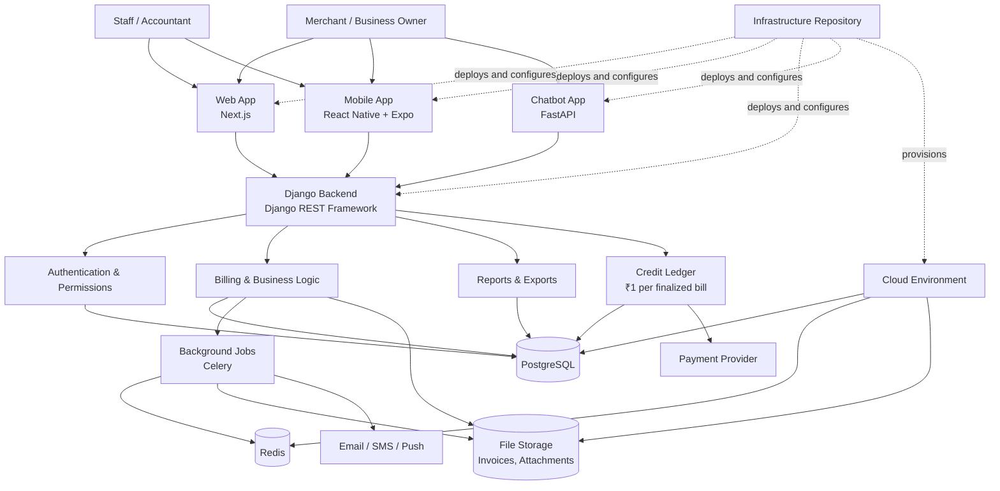

# Udyog Manager Architecture Flow

This diagram shows how the web app, mobile app, chatbot, backend, data services, and infrastructure relate to each other.



## Core principle

The web app, mobile app, and chatbot all use the Django backend as the single source of truth:

```text
Web + Mobile + Chatbot
            ↓
     Django API Backend
            ↓
 PostgreSQL + Redis + Storage
```

This ensures that billing, credit deduction, invoice numbering, permissions, and accounting rules work consistently across every channel.
